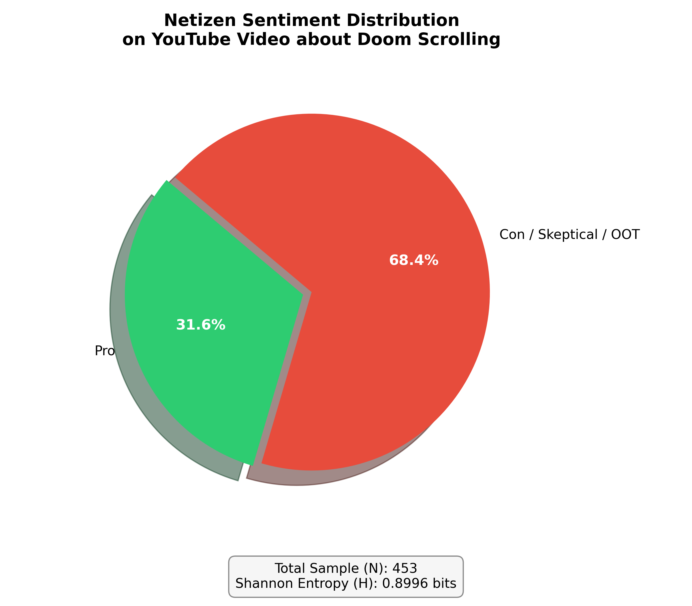
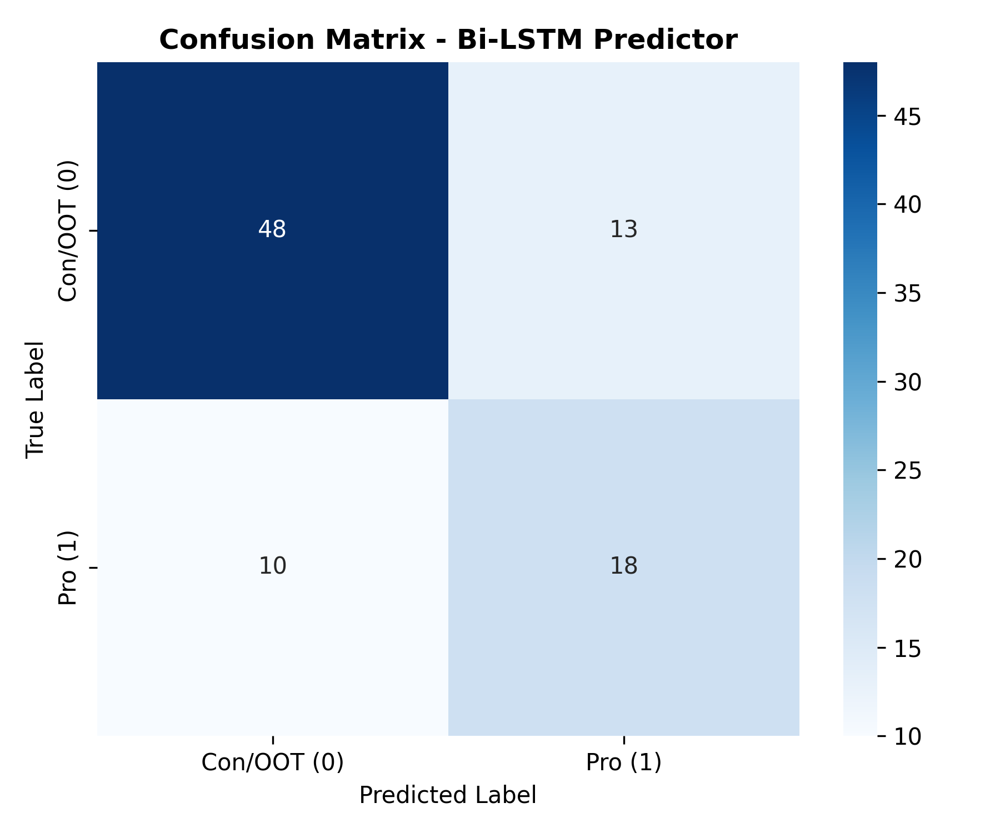
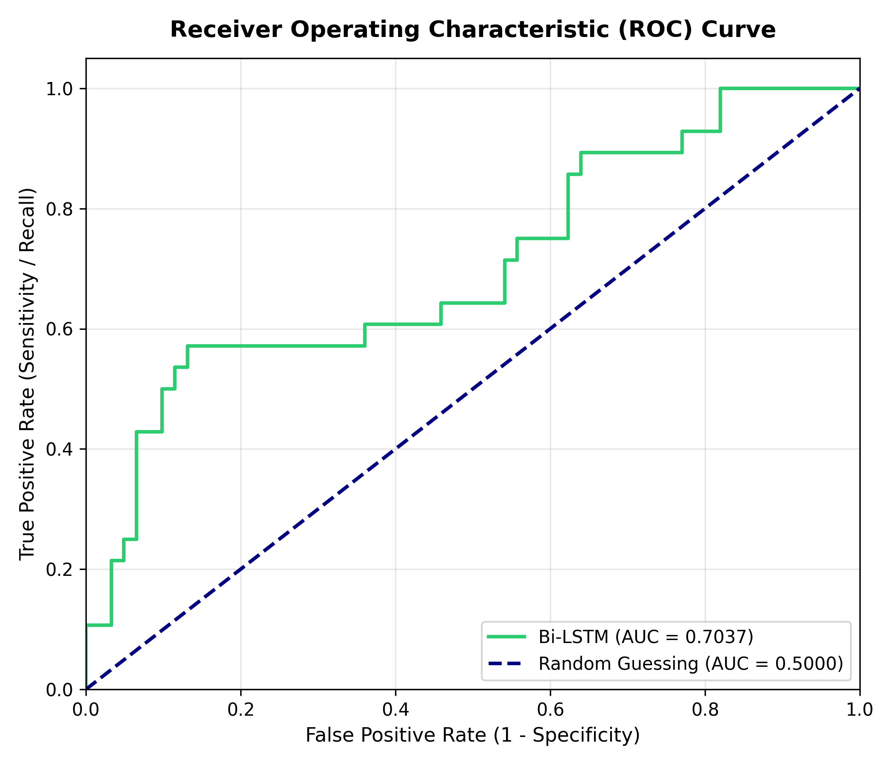
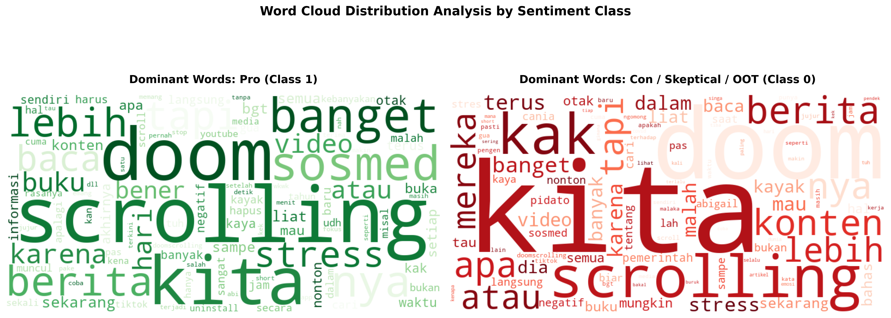

# My previous sentiment analysis experiment (about sentiment analysis on a content about digital detox and doom scrolling) suffered from a lack of dataset, so I build this.



## Overview
An end-to-end data science experiment exploring public sentiment on a YouTube Video about Doom Scrolling in Indonesia.

## Backgrounds
After finishing my first ever sentiment analysis experiment on my GitHub repo:

https://github.com/jovan-AIcoder/sentiment-analysis-on-digital-detox

I noticed that the dataset on that experiment is very small (10 samples only!), so my Bidirectional LSTM (BI-LSTM) model is not trained properly at that experiment. This happens because language models (even for BI-LSTM) must be trained on large datasets.

Because of that, **I've done that experiment again in this repo, but I took samples of comments from a YouTube video about Doom Scrolling.** The video is published from a channel in Indonesia, and **the comments also are in Indonesian language.** The pipeline of this experiment is still same, the difference is only on the dataset size. In this experiment, I've trained my BI-LSTM model so well on **453 comments.**

## Experimental Results
The results of this experiment are not much different from those of the previous experiment (see at the figure above). The most different thing is about the confusion matrix and the ROC curve, which is shown below.





And also, the wordcloud analysis:



**I have obtained a much richer dataset than previous experiments!** From this dataset, the behavioural of the doom scroller can be determined, and the BI-LSTM model can be trained properly. 
Also, I've tuned some hyperparameters of the model, and this is the final evaluation results:

```plaintext
Classification Report:
              precision    recall  f1-score   support

 Con/OOT (0)       0.83      0.79      0.81        61
     Pro (1)       0.58      0.64      0.61        28

    accuracy                           0.74        89
   macro avg       0.70      0.71      0.71        89
weighted avg       0.75      0.74      0.74        89
```

## New in This Experiment: `inference.py`
In this experiment, I made a Python script for inference (just type `py inference.py` on your terminal after cloning this repo and running `pip install -r requirements.txt`), which is a Python script to use the trained BI-LSTM model to predict other comments' sentiment.

## Author
Jovan, 2026

Licensed under MIT License.